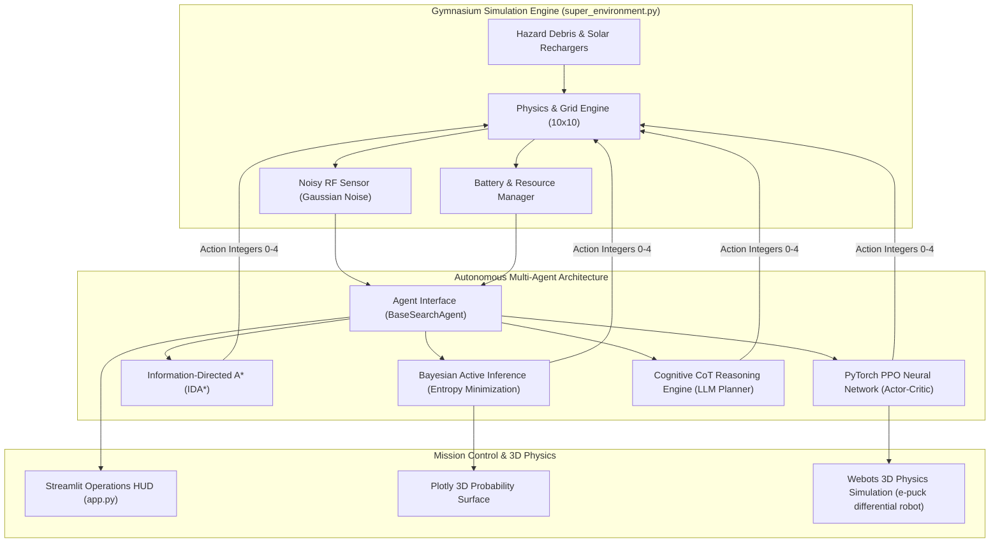
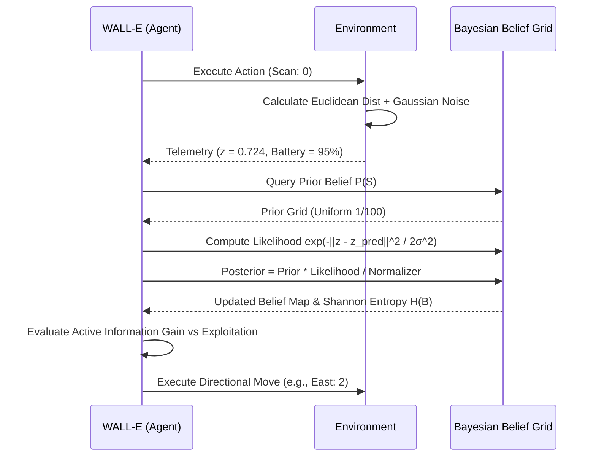

# 🛰️ SYSTEM ARCHITECTURE & MATHEMATICAL SPECIFICATION
**Project:** Operation Axiom (Deep Space Autonomous POMDP Search System)  
**Author:** Shaan Ahamed M (25BCE2196)

---

## 1. System Topology Overview

---

## 2. Mathematical Formalization

### 2.1 The POMDP Tuple
The search-and-rescue problem is formulated as a Partially Observable Markov Decision Process:
$$\mathcal{M} = \langle \mathcal{S}, \mathcal{A}, \mathcal{T}, \mathcal{R}, \Omega, \mathcal{O}, \gamma \rangle$$

1. **State Space $\mathcal{S}$**:
   $$s_t = \left( x_{agent}, y_{agent}, x_{target}, y_{target}, b_t, \mathcal{X}_{obs} \right) \in [0, M-1] \times [0, N-1] \times [0, M-1] \times [0, N-1] \times [0, B_{max}] \times 2^{\mathbb{Z}^2}$$

2. **Action Space $\mathcal{A}$**:
   $$\mathcal{A} = \{ 0: \text{SCAN}, 1: \text{NORTH}, 2: \text{EAST}, 3: \text{SOUTH}, 4: \text{WEST} \}$$

3. **Observation Space $\Omega$**:
   Continuous signal reading $z_t \in [0.0, 1.0]$:
   $$z_t = \text{clip}\left( \max\left(0, 1 - \frac{d(p_{agent}, p_{target})}{D_{max}}\right) + \epsilon_t, 0.0, 1.0 \right), \quad \epsilon_t \sim \mathcal{N}(0, \sigma^2)$$

4. **Reward Function $\mathcal{R}(s, a, s')$**:
   $$\mathcal{R}(s, a, s') = \begin{cases} 
   +120.0 & \text{if } p_{agent}' = p_{target} \text{ (Success)} \\
   -60.0 & \text{if } b' \le 0 \text{ (Depletion)} \\
   -5.0 & \text{if } p_{agent}' \in \mathcal{X}_{obs} \text{ (Collision)} \\
   +4.0 & \text{if } p_{agent}' \in \mathcal{X}_{recharge} \text{ (Energy harvest)} \\
   -0.5 - 0.5 \cdot \mathbb{I}(a = 0) + 1.5 \cdot (d_t - d_{t+1}) & \text{otherwise (Step cost + PBRS)}
   \end{cases}$$

---

## 3. Recursive Bayesian Estimation & Shannon Entropy

### 3.1 Shannon Entropy Derivation
Information entropy over the discrete belief grid $B(x, y)$ measures the expected information deficit in bits:
$$H(B) = -\sum_{x=0}^{M-1} \sum_{y=0}^{N-1} B(x, y) \log_2(B(x, y))$$
- Minimum Entropy: $H = 0$ bits (certainty, Dirac delta peak over true target).
- Maximum Entropy: $H = \log_2(M \cdot N) = \log_2(100) \approx 6.6438$ bits (complete ignorance, uniform distribution).

---

## 4. Deep Reinforcement Learning Architecture

### 4.1 Policy Network (Actor-Critic PPO)
- **Input Observation Vector** ($\mathbb{R}^6$):
  $$\mathbf{o}_t = \left[ \frac{x_t}{M-1}, \frac{y_t}{N-1}, \frac{b_t}{B_{max}}, z_t, \frac{d_{min}(p_t, \mathcal{X}_{rec})}{D_{max}}, \frac{t}{T_{max}} \right]$$
- **Feature Extractor**: 2-layer Multi-Layer Perceptron (MLP) with 128 hidden units each, Tanh activations.
- **Actor Head**: Softmax over 5 discrete logits $\pi_\theta(a \mid o_t)$.
- **Critic Head**: Scalar linear projection for state-value estimation $V_\phi(o_t)$.

### 4.2 Generalized Advantage Estimation (GAE)
$$\hat{A}_t^{GAE(\gamma, \lambda)} = \sum_{l=0}^\infty (\gamma \lambda)^l \delta_{t+l}^V, \quad \text{where } \delta_t^V = r_t + \gamma V(s_{t+1}) - V(s_t)$$

---

## 5. Webots 3D Physics Integration

The physical simulation runs in Webots R2025a using an **e-puck** differential two-wheeled mobile robot:
- **Chassis Dimensions**: Diameter $74\text{ mm}$, Wheel diameter $40\text{ mm}$, Axle length $53\text{ mm}$.
- **Differential Kinematics**:
  $$v = \frac{r}{2}(v_r + v_l), \quad \omega = \frac{r}{L}(v_r - v_l)$$
  where $r$ is wheel radius and $L$ is distance between wheels.
- **Supervisor Coordinate Transform**:
  $$X_{grid} = \text{clip}\left(\left\lfloor \frac{X_{3D} + 1.5}{0.3} \right\rfloor, 0, 9\right), \quad Y_{grid} = \text{clip}\left(\left\lfloor \frac{Y_{3D} + 1.5}{0.3} \right\rfloor, 0, 9\right)$$
